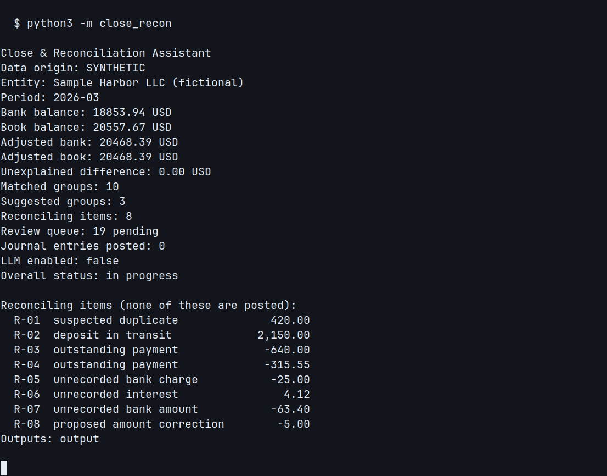
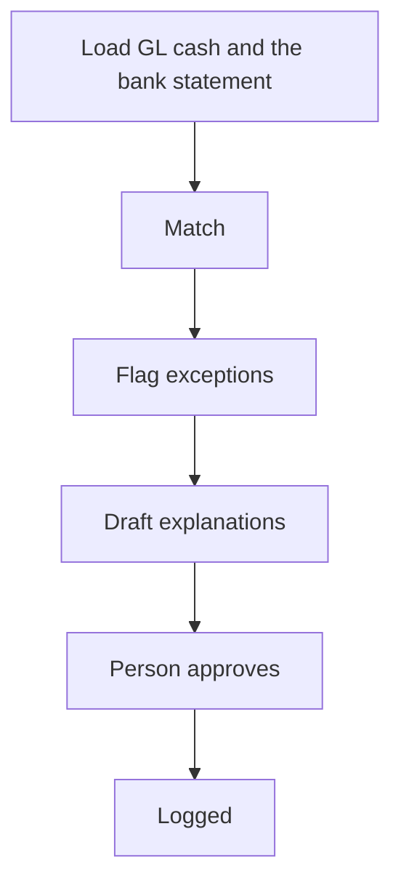

# close-recon-assistant

**AI drafts the reconciliation. People approve the numbers.**

[](https://github.com/tishan-perera/close-recon-assistant/actions/workflows/ci.yml)




> **Synthetic demo data, not a product.** Sample Harbor LLC is fictional. The books in `sample-data/` were written for this demo. There are no account numbers, no client records, and no live bank or ERP connection. Nothing in this repository posts a journal entry.

## Quick start

Python 3.11 or newer. No install is required for the demo, and no API key. The run below is deterministic. The model step is off.

```bash
git clone https://github.com/tishan-perera/close-recon-assistant.git
cd close-recon-assistant
python3 -m close_recon
```

That writes `output/` (gitignored). The same command, with the default as-of timestamp `2026-04-02T15:00:00+00:00`, is what produced `examples/sample-output/`. A test fails if those files drift.

A reviewer file records decisions without posting. Approved rows stay `approved_not_posted`.

```bash
python3 -m close_recon --decisions examples/decisions.sample.csv --output output/reviewed
```

The console script is optional:

```bash
python3 -m venv .venv && source .venv/bin/activate
pip install -e .
close-recon
```

Tests and the metric recount:

```bash
python3 -m unittest discover -s tests -v
python3 scripts/sample_metrics.py
```

Lint, after `pip install -e ".[dev]"`:

```bash
ruff check . && ruff format --check .
```

## How a close moves



On this path the draft is the rules engine. It writes a reason and a confidence for every match, exception, and expense category, then stops. A person approves or rejects the open rows. The audit log records the engine's draft and the person's decision.

An optional in-process model can replace a weak category draft. It runs only when Python code passes `Settings(enable_llm=True)` and a function. An environment variable cannot turn it on. `python3 -m close_recon --enable-llm` exits with an error. This repository has no network client, no SDK, and no credential lookup. A model suggestion still goes to a person when its confidence is under 0.75, and it still does not post.

Matching runs in this order. A pair clears only when the rule has one candidate. The confidence figures are constants in the matcher, not a measured accuracy score.

| Order | Rule | When it is the only candidate |
| --- | --- | --- |
| 1 | Same amount, same date, same reference | Cleared match, confidence 1.00 |
| 2 | Same amount and reference, dates 1 to 5 days apart | Cleared timing match, confidence 0.95 |
| 3 | Same amount inside the date window, and at least one reference is blank | Suggestion, confidence 0.70 |
| 4 | Same reference, date window, amount difference within 10.00 and 2 percent | Suggestion, confidence 0.62 |
| 5 | One bank line equals a unique sum of 2 or 3 ledger lines in the window | Suggestion, confidence 0.58 |

Positive amounts are cash in. Negative amounts are cash out.

## What it demonstrates

- A month-end cash bridge for one fictional operating account: what cleared, what is still open because of timing, and what sits on one side only.
- Exceptions built into the fictional month: a check that clears later, a deposit in transit, a duplicate draft, a five-dollar amount difference, a blank reference, a batched deposit, a bank fee, interest, and an unidentified card purchase.
- Expense coding with a confidence and a reason. Vague, conflicting, and duplicate bills stay in the review queue. High-confidence rows are suggestions too, because nothing auto-posts.
- A checklist and an audit log. Sign-off is a row in the decision file. It does not post.

## Sample month

The table is `eval/sample_metrics.json`, produced by `python3 scripts/sample_metrics.py` from one offline run of `sample-data/`. `tests/test_metrics.py` fails if that file drifts from a fresh run. `tests/test_readme.py` fails if the table drifts from the file. These are counts for one made-up month. They are not a production accuracy score.

| Measure | Value |
| --- | --- |
| Bank lines classified | 17 of 17 |
| Ledger lines classified | 17 of 17 |
| Expense lines | 12 |
| Matched groups | 10 |
| Suggested groups | 3 |
| Duplicate flags | 1 |
| Ambiguous pairs left open | 0 |
| Reconciling items | 8 |
| Review queue still pending | 19 |
| Categories flagged for review | 4 |
| Category drafts from rules | 12 |
| Category drafts from a model | 0 |
| Journal entries posted | 0 |
| Model step enabled | false |
| Unexplained difference (USD) | 0.00 |
| Bank balance (USD) | 18853.94 |
| Book balance (USD) | 20557.67 |
| Adjusted bank (USD) | 20468.39 |
| Adjusted book (USD) | 20468.39 |
| Audit events | 53 |

| Match rule | Groups |
| --- | --- |
| exact | 8 |
| amount_ref_date_window | 2 |
| amount_date_missing_ref | 1 |
| amount_tolerance_exact_ref | 1 |
| group_sum | 1 |

Command output for that run:

```text
Close & Reconciliation Assistant
Data origin: SYNTHETIC
Entity: Sample Harbor LLC (fictional)
Period: 2026-03
Bank balance: 18853.94 USD
Book balance: 20557.67 USD
Adjusted bank: 20468.39 USD
Adjusted book: 20468.39 USD
Unexplained difference: 0.00 USD
Matched groups: 10
Suggested groups: 3
Reconciling items: 8
Review queue: 19 pending
Journal entries posted: 0
LLM enabled: false
Overall status: in progress

Reconciling items (none of these are posted):
  R-01  suspected duplicate              420.00
  R-02  deposit in transit             2,150.00
  R-03  outstanding payment             -640.00
  R-04  outstanding payment             -315.55
  R-05  unrecorded bank charge           -25.00
  R-06  unrecorded interest                4.12
  R-07  unrecorded bank amount           -63.40
  R-08  proposed amount correction        -5.00
```

An unexplained difference of 0.00 means the opening balances agree and every loaded line was classified. It does not mean a reviewer has approved the open items. The review file still has 19 pending rows, and 4 expense drafts are flagged. None of the proposed book adjustments are posted.

## Limits

- One fictional month, one cash account, US dollars. Sample Harbor LLC is not a real entity.
- Keyword categories are a baseline a person maintains. They are brittle, and they are not a judgment about a business.
- The matcher misses partial payments, instalments, many-to-many batches above three lines, and foreign currency. Group suggestions stop above eight open lines.
- Duplicate detection is a two-day signature on amount and reference. It is not an anomaly model. A repeated monthly charge outside that window is left alone.
- Exact matches are logged and reported. This version cannot unmatch one from the review file.
- There is no ERP connection and no live model. The default command does not use the network.

## Layout

| Path | What is there |
| --- | --- |
| `close_recon/` | Load, match, bridge, categories, review, audit, and the report |
| `sample-data/` | Fictional March 2026 bank, ledger, and vendor files |
| `examples/sample-output/` | Output of the default command, checked by a test |
| `examples/decisions.sample.csv` | A fictional approve and reject file |
| `examples/decisions.template.csv` | Empty decision file with the required columns |
| `eval/sample_metrics.json` | Counts from the sample run |
| `scripts/sample_metrics.py` | Recomputes those counts |
| `tests/` | Standard-library unit tests. No API key and no network |
| `docs/cli-run.png` | Screenshot of the default command |

## License

MIT. See [LICENSE](LICENSE). Tishan Perera.
